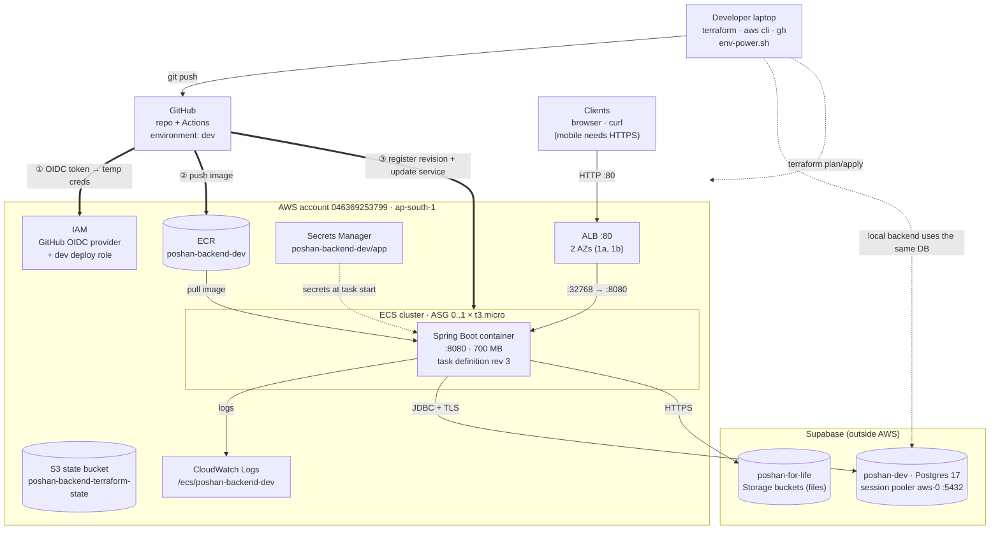
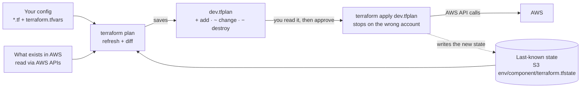
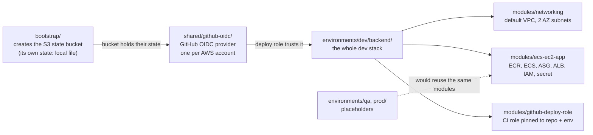
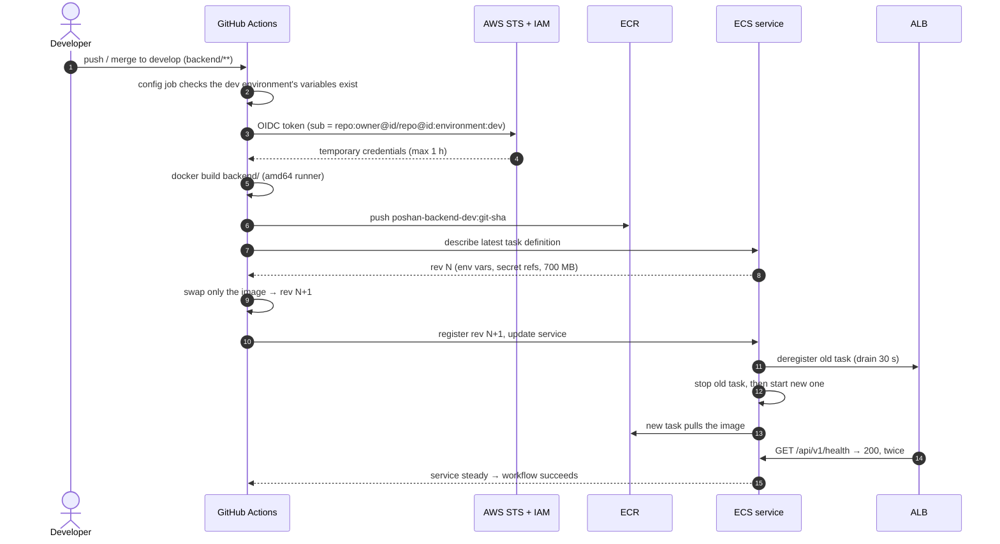
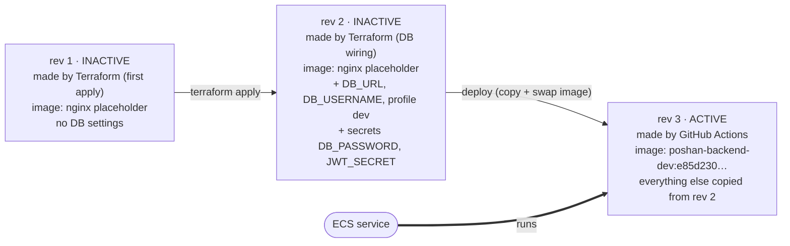
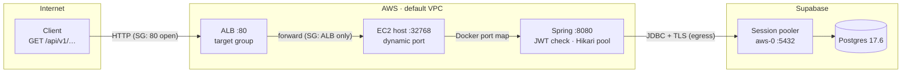
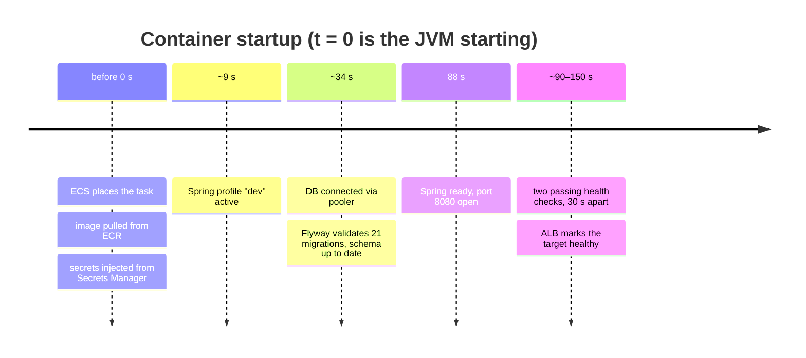
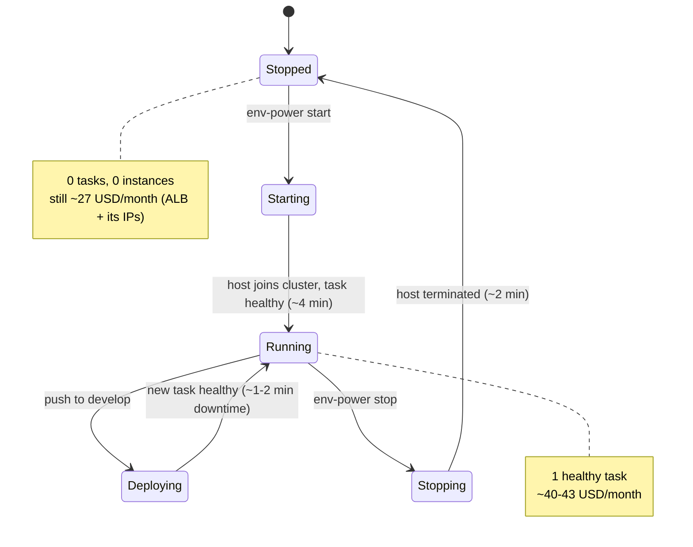
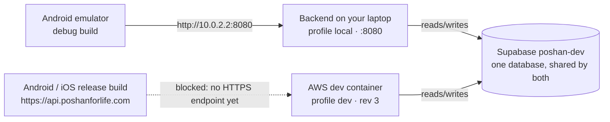
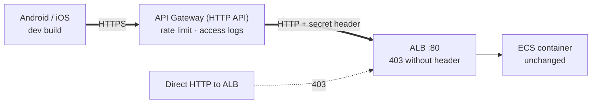

# Poshan for Life — Backend Architecture on AWS

How the Spring Boot backend gets from a commit to a running, reachable
service: what Terraform builds, what GitHub Actions ships, what happens to a
request, and how the dev environment is switched off to save credits.

Read this first if you're new. Then:

- [DEPLOYMENT.md](DEPLOYMENT.md): the runbook, with exact commands, day-to-day operations and troubleshooting.
- [README.md](README.md): Terraform folder layout, cost table, multi-account design.

> Diagrams are [Mermaid](https://mermaid.js.org/) and render on GitHub and in
> most IDE Markdown previews. Keep them in sync when you change the setup.

As of **2026-10-09**: only the **dev** environment exists. It runs task
definition revision 3 (commit `e85d230`) and is normally kept **stopped**
between uses.

---

## 1. The basic idea: four jobs, four tools

| Job | Tool | Runs | Changes |
|---|---|---|---|
| **Build the infrastructure** | Terraform, from a developer laptop | `terraform plan` / `apply` | Load balancer, cluster, roles, security groups, the secret container, the task definition *template* |
| **Ship the code** | GitHub Actions (`.github/workflows/backend-deploy-dev.yml`) | Every push to `develop` touching `backend/**` | Which image the service runs |
| **Serve requests** | ALB → ECS container → Supabase Postgres | Whenever dev is running | Data |
| **Turn it on and off** | `.iac/SKILLS/poshan-env-power/scripts/env-power.sh` | `start` / `stop` / `status dev` | Task count and EC2 count (0 ↔ 1) |

Each setting has exactly **one owner**. Terraform is told to ignore the
settings the other tools own (`ignore_changes` in
`modules/ecs-ec2-app/ecs.tf`); otherwise a `terraform apply` would undo a
deploy or restart a stopped environment. See [§4.3](#43-who-owns-what).

---

## 2. The whole system

**Trust zones:** the laptop has admin credentials; GitHub only ever gets
short-lived credentials through OIDC; the runtime lives inside AWS. The
database is at Supabase. The container reaches it through Supabase's **IPv4
session pooler** because the direct `db.<ref>.supabase.co` host is IPv6-only
and the AWS default VPC is IPv4-only.

---

## 3. The pieces, in one line each

| Piece | What it does here |
|---|---|
| **Terraform** | Code that describes the infrastructure. `plan` shows the difference between code and reality; `apply` makes reality match. |
| **State file** | Terraform's record of what it created and the real resource IDs. Lives in S3 so it isn't tied to one laptop. |
| **ECR** | Private Docker registry. Each deploy pushes an image tagged with the git commit SHA; the last 10 are kept. |
| **ECS cluster / service** | Runs the container. The *service* keeps the requested number of copies (0 or 1) running and replaces any that die. |
| **Task definition** | The container recipe: image, memory, port, env vars, secret references. Every change creates a numbered **revision**; the service runs one revision. |
| **EC2 + Auto Scaling group** | The single t3.micro the container runs on (ECS-optimized Amazon Linux 2023). The ASG relaunches it if it dies and is how stop/start removes or adds it. |
| **ALB** | Load balancer with a stable public address. Forwards HTTP to the container and health-checks `/api/v1/health` every 30 s. |
| **Security groups** | Firewalls. ALB: port 80 from anywhere. EC2 host: app ports only from the ALB; SSH only from one admin IP. |
| **OIDC** | GitHub proves "I am repo X, environment dev" with a signed token; AWS swaps it for credentials that expire within an hour. No AWS keys live in GitHub. |
| **Secrets Manager** | Holds `DB_PASSWORD` and `JWT_SECRET`. ECS injects them as env vars when the container starts. Never in git or Terraform state. |
| **Supabase session pooler** | IPv4 entry to Postgres on 5432. Session mode keeps the prepared statements Hibernate and Flyway rely on (the 6543 transaction pooler breaks them). |
| **Flyway** | Runs DB migrations on startup. The DB is at v20, the repo's latest, so boots report "Schema public is up to date". |

---

## 4. Job 1: building the infrastructure (Terraform)

### 4.1 How one change moves AWS from one state to the next

Terraform never acts on the code alone. It compares **three** inputs, and the
plan is their difference. `apply` performs exactly the saved plan and then
records the result.

Rules we follow:

- Always apply a **saved plan file**, so what gets applied is what was reviewed.
- Every root config has an **account guard**, `allowed_account_ids =
  ["046369253799"]` in `terraform.tfvars`. Terraform aborts if your
  credentials resolve to any other account.

### 4.2 Three separate Terraform projects, applied in order

- **Modules** hold reusable logic and don't know which environment they serve.
  Environment folders only pass names and sizes.
- **State layout** in `s3://poshan-backend-terraform-state/`:
  - `dev/backend/terraform.tfstate` and `shared/github-oidc/terraform.tfstate`.
  - Folders `local/`, `qa/` and `prod/` are reserved.
- **Multi-account ready:** every root config takes `aws_profile` and
  `allowed_account_ids`, so qa or prod can live in separate AWS accounts later
  without module changes. See [README.md](README.md#multi-account-future-separate-aws-accounts-for-qa--prod).

### 4.3 Who owns what

| Setting | Owner | Why |
|---|---|---|
| ALB, cluster, roles, security groups, secret container | Terraform | Infrastructure; changes only via plan/apply. |
| Task definition template (memory, env vars, secret references) | Terraform | A `main.tf` change registers a new revision. |
| Which revision the service runs (the image) | GitHub Actions | Each deploy registers a revision and points the service at it. |
| Task count (0/1) and ASG size (0/1) | `env-power.sh` | Start/stop. Terraform ignores them, so a stopped env stays stopped. |
| Secret **values** | A developer, with the AWS CLI | Keeps passwords out of Terraform state and plan output. |

---

## 5. Job 2: shipping the code (GitHub Actions)

### 5.1 A deploy, message by message

Why each step works this way:

1. **Trigger.** Only changes under `backend/**` (or to the workflow file) on
   `develop`. A first job checks that the `dev` environment's variables exist.
   If they don't, the deploy is **skipped**, not failed.
2. **Identity.** The deploy role trusts exactly
   `repo:dpdhirajpatil@264592782/PoshanForLife@1303041314:environment:dev`.
   This repo uses GitHub's *immutable* OIDC subject, which contains numeric
   owner and repo IDs. The GitHub Environment `dev` accepts only the `develop`
   branch. A fork, another branch, another repo, or a recreated repo with the
   same name cannot get credentials.
3. **Build.** The image is built on GitHub's amd64 runner (the t3.micro is
   amd64) and tagged with the full commit SHA, so every image traces back to
   a commit.
   - Local amd64 builds on Apple Silicon fail under QEMU emulation, so let CI
     do the building.
4. **New revision.** The workflow copies the **latest** task definition (the
   one Terraform last wrote) and changes only the image. DB settings, secret
   references and memory carry over untouched.
5. **Rollout.** Two copies don't fit on a t3.micro, so ECS **stops the old
   task first** (minimum healthy 0%), then starts the new one: about 1–2 min
   of dev downtime per deploy.
   - The workflow waits up to 15 min for the new task to be healthy.

**GitHub configuration:** Environment `dev` has 7 plain variables:
`AWS_REGION`, `AWS_DEPLOY_ROLE_ARN`, `ECR_REPOSITORY`, `ECS_CLUSTER`,
`ECS_SERVICE`, `ECS_TASK_FAMILY` and `CONTAINER_NAME`. None are secrets.
Their values come from `terraform output github_environment_variables`.

### 5.2 How the running container definition evolved

Terraform edits the recipe; deploys choose which recipe runs. To **roll back**,
point the service at an older revision:
`aws ecs update-service --cluster poshan-backend-dev-cluster --service poshan-backend-dev-service --task-definition poshan-backend-dev:<rev>`.

> Adding a new env var or secret: change `environments/dev/backend/main.tf`
> and apply, which creates a new revision. Then **deploy**: Terraform never
> moves the service to a new revision by itself. Details: [DEPLOYMENT.md §4](DEPLOYMENT.md#4-day-to-day-operations).

---

## 6. Job 3: serving requests

### 6.1 One request

- The **ALB is the only public way in**. The host accepts the app's ports
  only from the ALB's security group, and SSH only from one admin IP.
- Traffic is **plain HTTP** for now. That's why the Android/iOS release
  builds can't use dev yet: both platforms require HTTPS (see [§9](#9-whats-next)).
- All 46 Supabase tables have **row-level security** on, so Supabase's public
  data API can't read them with the anon key.

### 6.2 What happens when a container starts

Times are from the CloudWatch logs of the 2026-09-27 deploy:

The service has a **180 s health-check grace period**. Without it, the ALB
would mark the app unhealthy and ECS would kill it mid-boot (Spring takes
about 80–90 s on a t3.micro).

---

## 7. Job 4: turning dev on and off

- **Stopped is not $0.** The ALB and its two public IPs keep billing. Only
  `terraform destroy` brings dev to $0, and that also deletes the ECR images
  and changes the ALB address.
- **ECS managed draining:** a scaled-in instance waits in
  `Terminating:Wait` (still billed) until ECS releases it. The script reports
  "Stopped" only once the ASG holds no instance at all.
- **Deploying while stopped** still works: the new revision is registered and
  goes live at the next `start`.
- **Terraform can't restart a stopped env.** It ignores the task count and
  ASG size these scripts change.

---

## 8. Local development and the mobile apps

- `backend/.env` points the local backend at the **same** `poshan-dev`
  database as AWS dev:
  - **Data:** anything you create locally shows up in deployed dev straight
    away.
  - **Migrations:** a Flyway migration run locally changes the schema deployed
    dev uses, so deploy the matching code promptly. If you'd rather keep them
    apart, use a separate database.
- File uploads in both environments live in the `poshan-for-life` Supabase
  project's Storage.
- Debug builds may use cleartext HTTP only to `10.0.2.2` and `localhost`
  (`android/app/src/debug/res/xml/network_security_config.xml`). Release builds
  are HTTPS-only.

---

## 9. What's next

**HTTPS front door for the mobile apps (proposed, not built).** API Gateway
(HTTP API) gives an HTTPS address immediately, with an AWS certificate and no
domain needed. It forwards to the existing ALB and adds a secret header; the
ALB returns 403 to anything without it.

Limits to check before relying on it:

- **30 s timeout:** API Gateway cuts off longer requests, and the AI report
  analysis may be slower.
- **10 MB requests:** API Gateway caps request bodies at 10 MB, while Spring
  allows 11 MB.

A later step could replace the ALB with a private VPC link and save about
$25/month. Production would add Route 53 + ACM for
`api.poshanforlife.com`.

**Other open items:**

- Delete the deprecated `modules/jenkins` and `shared/jenkins`, replaced by
  GitHub Actions.
- Add the remaining app keys to `poshan-backend-dev/app` as features need
  them.
- Add S3 state locking before more than one person runs `terraform apply`.

---

## 10. Cost at a glance

| Item | ≈ USD / month | While stopped |
|---|---:|---|
| ALB (hourly + minimal usage) | 18–20 | still billed |
| Public IPv4 × 2 (ALB) | 7.30 | still billed |
| EC2 t3.micro | 8 | $0 |
| Public IPv4 (EC2 host) | 3.65 | $0 |
| EBS 30 GB | 2.70 | $0 |
| Secret, ECR, logs, S3 state | ≈ 1.40 | still billed |
| Supabase, GitHub Actions, IAM, ECS control plane | 0 | $0 |
| **Total** | **≈ 40–43 running** | **≈ 27 stopped** |

The AWS account is on the **credit-based Free plan**: no 750-hour free tier,
and everything draws down credits. The plan ends **2027-02-18**; upgrade to a
paid plan before then or AWS closes the account. Prices are approximate
ap-south-1 on-demand rates; the Billing console has the exact figures.
