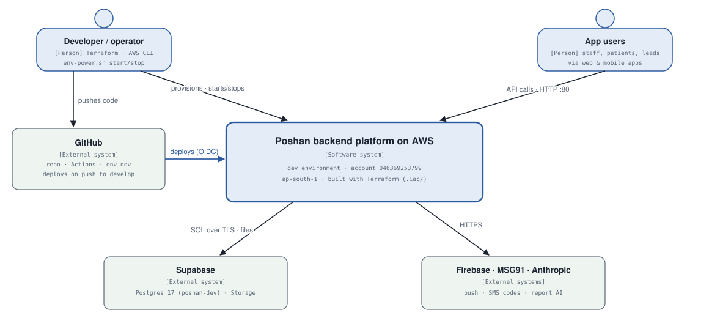
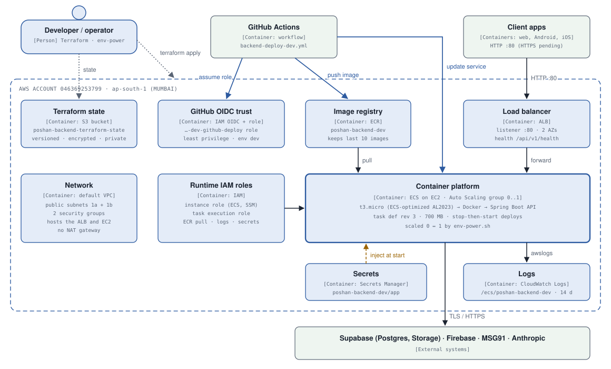
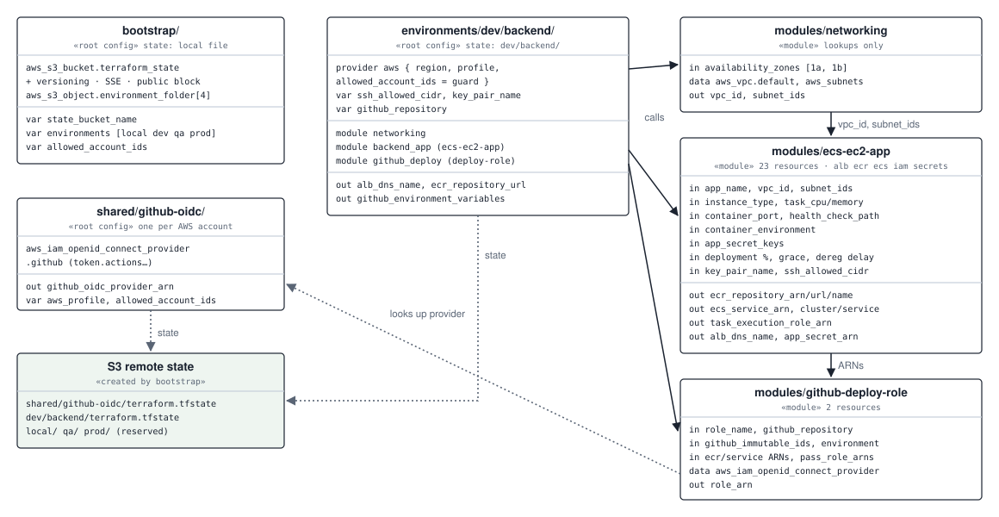
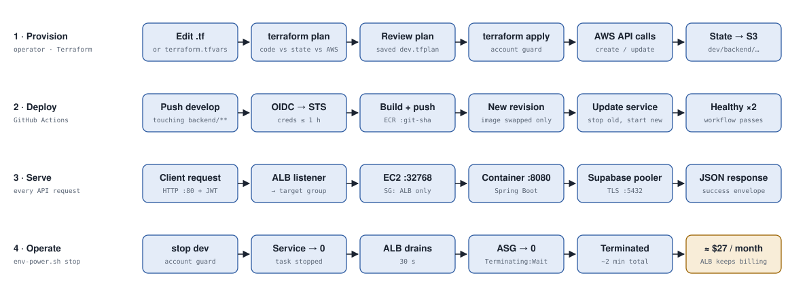

# Poshan for Life — AWS Infrastructure C4 Model

The AWS side of the Poshan backend at every [C4](https://c4model.com/) level,
plus the workflows that run on it and what every AWS component is for.

Here the **system** is the AWS platform the backend runs on. So the
**containers** are infrastructure building blocks (load balancer, container
platform, registry, …) and the **components** are the individual AWS
resources in the dev stack.

| Level | Diagram | Shows |
|---|---|---|
| C1 | [System context](#c1--system-context) | Operator, GitHub, app users, Supabase and SaaS around the platform |
| C2 | [Containers](#c2--containers) | State, OIDC trust, registry, load balancer, network, roles, container platform, secrets, logs |
| C3 | [Components](#c3--components-dev-backend-stack) | The 25 resources of `environments/dev/backend` and how they reference each other |
| C4 | [Code](#c4--code-terraform) | Terraform projects and modules, and the blocks that create the key behaviours |
| — | [Workflows](#workflows) | Provision, deploy, serve, operate |
| — | [Component catalogue](#aws-component-catalogue) | Every AWS component: role, significance, cost |

Related docs:

- [`C4-MODEL.md`](C4-MODEL.md): the application (Spring Boot API) at C1–C4.
- [`.iac/ARCHITECTURE.md`](../../.iac/ARCHITECTURE.md): flow diagrams.
- [`.iac/DEPLOYMENT.md`](../../.iac/DEPLOYMENT.md): the runbook with exact commands.

Diagrams are hand-drawn SVGs in [`images/`](images/). They're plain text, so
update them in the same change that alters the infrastructure.

*As of 2026-10-10, from `.iac/` and the live Terraform state:*

- Account `046369253799`, region `ap-south-1`.
- 34 managed resources: 8 (bootstrap), 1 (OIDC) and 25 (dev).
- Dev is stopped, on task definition rev 3.

---

## C1 — System context



There are three ways in, each with a different scope of change:

| Who | Through | Can change |
|---|---|---|
| Developer / operator | Terraform, AWS CLI, `env-power.sh` | Infrastructure; dev on/off; secret values |
| GitHub Actions | OIDC → deploy role | Only which image the service runs |
| App users | ALB, HTTP :80 | Nothing in the infrastructure; they only send requests |

Supabase (Postgres, Storage) and the SaaS APIs (Firebase, MSG91, Anthropic)
are outside AWS and reached over the internet.

---

## C2 — Containers



| Container | AWS service | Created by | Purpose |
|---|---|---|---|
| Terraform state | S3 | `bootstrap/` | Remote state for the other configs, one key per environment |
| GitHub OIDC trust | IAM (OIDC provider + role) | `shared/github-oidc/` + `github-deploy-role` | Lets CI deploy without stored AWS keys |
| Image registry | ECR | `ecs-ec2-app` | Versioned images, one per commit |
| Load balancer | Elastic Load Balancing (ALB) | `ecs-ec2-app` | Stable public endpoint and health checks |
| Network | Default VPC, security groups | `networking` (lookup) + `ecs-ec2-app` | Where the ALB and host live; who may talk to whom |
| Runtime IAM roles | IAM | `ecs-ec2-app` | Permissions for the host, and for ECS acting on the task's behalf |
| Container platform | ECS on EC2 + Auto Scaling | `ecs-ec2-app` | Runs the Spring Boot API container |
| Secrets | Secrets Manager | `ecs-ec2-app` (container only) | DB password and JWT secret, injected at start |
| Logs | CloudWatch Logs | `ecs-ec2-app` | Container output for debugging |

The container platform is the only block that runs anything. Every other
block does one of four jobs for it:

- **feeds it:** the image, secrets, network and roles
- **exposes it:** the load balancer
- **observes it:** the logs
- **manages it:** the state and the OIDC trust

---

## C3 — Components: dev backend stack


Read it along two paths:

- **Request path (top row):**
  1. The ALB security group lets port 80 in.
  2. The ALB passes traffic to the :80 listener.
  3. The listener forwards to the target group, which knows the task's dynamic
     host port.
- **Hosting path (left columns):**
  1. The ECS service places its task through the capacity provider.
  2. The capacity provider scales the Auto Scaling group (0..1).
  3. The Auto Scaling group launches a host from the launch template.
  4. The launch template supplies the ECS-optimized AMI and the instance
     profile.

**The ECS service is the hub.** It:

- registers tasks in the target group
- runs the current task-definition revision
- is the thing the GitHub deploy role is allowed to update

The task definition points at:

- the **execution role**, which may read only `poshan-backend-dev/*` secrets
- the **log group**
- the **ECR image**

Grey boxes (default VPC, key pair) are looked up or created outside Terraform.

---

## C4 — Code: Terraform



**Three root configs, each with its own state, applied in order:**

1. `bootstrap/`: the state bucket. Its own state is a local file.
2. `shared/github-oidc/`: the OIDC provider, one per AWS account.
3. `environments/dev/backend/`: the dev stack.

**How the dev root wires the modules together:**

- It passes `networking`'s `vpc_id` and `subnet_ids` into `ecs-ec2-app`.
- It passes `ecs-ec2-app`'s ARNs into `github-deploy-role`.

Modules know nothing about "dev": the environment folder only passes names and
sizes. So QA or prod is a new folder (possibly in another AWS account, via
`aws_profile` + `allowed_account_ids`) calling the same modules.

### The blocks behind the key behaviours

These are abridged from `.iac/modules/`, showing only the lines that create
each behaviour.

**ECS service: deploys and start/stop don't fight Terraform**
(`modules/ecs-ec2-app/ecs.tf`)

```hcl
resource "aws_ecs_service" "app" {
  desired_count                      = 1
  health_check_grace_period_seconds  = var.health_check_grace_period_seconds  # 180 in dev
  deployment_minimum_healthy_percent = var.deployment_minimum_healthy_percent # 0 in dev
  deployment_maximum_percent         = var.deployment_maximum_percent         # 100 in dev

  capacity_provider_strategy {
    capacity_provider = aws_ecs_capacity_provider.app.name
    weight            = 100
  }
  load_balancer {
    target_group_arn = aws_lb_target_group.app.arn
    container_name   = var.app_name
    container_port   = var.container_port
  }
  lifecycle {
    ignore_changes = [task_definition, desired_count]
  }
  depends_on = [aws_lb_listener.http, aws_ecs_cluster_capacity_providers.app]
}
```

- **Two settings belong to other tools:** CI owns the running revision, and
  `env-power.sh` owns the task count, so Terraform ignores both.
- **Deploys stop the old task first** (0% / 100%), because two 700 MB copies
  don't fit on a t3.micro.

**Auto Scaling group: a stopped environment stays stopped**

```hcl
resource "aws_autoscaling_group" "ecs_instance" {
  desired_capacity    = 1
  min_size            = 1
  max_size            = 1
  vpc_zone_identifier = var.subnet_ids
  launch_template {
    id      = aws_launch_template.ecs_instance.id
    version = "$Latest"
  }
  tag {
    key                 = "AmazonECSManaged"
    value               = ""
    propagate_at_launch = true
  }
  lifecycle {
    ignore_changes = [desired_capacity, min_size]
  }
}
```

- **Two things resize the group at runtime:** the capacity provider and
  `env-power.sh`.
- **Terraform ignores the size**, so `terraform apply` never silently restarts
  a stopped environment.

**Task definition: secrets by reference, logs to CloudWatch**

```hcl
container_definitions = jsonencode([{
  environment = [
    for k in sort(keys(var.container_environment)) : { name = k, value = var.container_environment[k] }
  ]
  secrets = [
    for k in var.app_secret_keys : { name = k, valueFrom = "${aws_secretsmanager_secret.app[0].arn}:${k}::" }
  ]
  portMappings = [{ containerPort = var.container_port, hostPort = 0, protocol = "tcp" }]
  logConfiguration = {
    logDriver = "awslogs"
    options = {
      "awslogs-group"         = aws_cloudwatch_log_group.app.name
      "awslogs-region"        = data.aws_region.current.name
      "awslogs-stream-prefix" = "ecs"
    }
  }
}])
```

- **Secrets by reference:** only the secret's ARN and key are in Terraform.
  ECS fetches the values when the task starts.
- **Dynamic port:** `hostPort = 0` lets Docker pick a free port, which the
  target group tracks.

**Least privilege: secrets, CI and the account guard**

```hcl
# modules/ecs-ec2-app/iam.tf: the task may read only its own environment's secrets
resource "aws_iam_role_policy" "task_execution_secrets" {
  role = aws_iam_role.task_execution.id
  policy = jsonencode({
    Version   = "2012-10-17"
    Statement = [{
      Effect   = "Allow"
      Action   = ["secretsmanager:GetSecretValue"]
      Resource = "arn:aws:secretsmanager:*:*:secret:${var.app_name}/*"
    }]
  })
}

# modules/github-deploy-role/main.tf: trust pinned to repo IDs + GitHub Environment
"token.actions.githubusercontent.com:sub" = "${local.subject_repo}:environment:${var.github_environment}"
#   = "repo:dpdhirajpatil@264592782/PoshanForLife@1303041314:environment:dev"

# every root config: refuse to run against any other AWS account
provider "aws" {
  region              = var.aws_region
  profile             = var.aws_profile
  allowed_account_ids = length(var.allowed_account_ids) > 0 ? var.allowed_account_ids : null
}
```

---

## Workflows



### 1 · Provision (Terraform, by the operator)

1. Change a module, an environment's `main.tf`, or its `terraform.tfvars`.
2. Run `terraform plan -out=dev.tfplan`. It compares the code, the S3 state
   and the real account.
3. Read the plan. Prod also needs a second explicit approval.
4. Run `terraform apply dev.tfplan`. It applies exactly what was reviewed, and
   only in account `046369253799`.
5. The new state is written back to S3. The bucket is versioned, so a bad
   write can be rolled back.

### 2 · Deploy (GitHub Actions)

1. A push or merge to `develop` touches `backend/**`.
2. The job exchanges GitHub's OIDC token for 1-hour credentials of the deploy
   role.
3. It builds the image on an amd64 runner and pushes `:<git sha>` to ECR.
4. It copies the latest task definition, swaps only the image, and registers a
   new revision.
5. It updates the service. ECS stops the old task, starts the new one, and the
   workflow waits for two healthy checks.

### 3 · Serve (every request)

1. The client calls the ALB on port 80. That's the only public entry; HTTPS is
   still pending.
2. The listener forwards to the target group, which knows the task's dynamic
   host port.
3. The host's security group accepts the request only from the ALB. Docker
   maps it to port 8080 in the container.
4. Spring checks the JWT, then queries Postgres through Supabase's IPv4 session
   pooler over TLS.

### 4 · Operate (start/stop, secrets, logs)

- **Stop:** `env-power.sh stop dev` scales the service to 0, then the Auto
  Scaling group, and waits for ECS managed draining to finish. It takes about
  2 minutes, and dev then costs about $27/month.
- **Start:** `env-power.sh start dev` reverses this. It takes about 4 minutes
  to healthy, including about 85 s for Spring to boot.
- **Secrets:** change the values with `aws secretsmanager put-secret-value`,
  then force a new deployment so the task reads them.
- **Logs:** `aws logs tail /ecs/poshan-backend-dev --follow --region ap-south-1`.

---

## AWS component catalogue

| Component | Terraform | Role here | Significance | ≈ USD/mo |
|---|---|---|---|---:|
| **State & identity** | | | | |
| S3 state bucket | `aws_s3_bucket` + versioning, SSE, public access block, 4 folder objects | Remote state for every root config | One shared, recoverable source of truth; versioned, encrypted, private, `prevent_destroy` | ≈ 0 |
| IAM OIDC provider | `aws_iam_openid_connect_provider.github` | Trusts GitHub's token issuer | No long-lived AWS keys stored in GitHub | 0 |
| GitHub deploy role + policy | `github-deploy-role` module | Push to this ECR repo, register task definitions, update this service, pass the execution role | Least privilege; trust pinned to repo IDs and the `dev` environment | 0 |
| STS | used, not created | Issues the 1-hour CI credentials | Short-lived access only | 0 |
| **Network & edge** | | | | |
| Default VPC + 2 public subnets | `data aws_vpc` / `aws_subnets` (networking) | Network for the ALB and host (ap-south-1a, 1b) | Avoids a NAT gateway (≈ $32/mo); the host reaches the internet via its public IP | 0 |
| ALB security group | `aws_security_group.alb` | Allows port 80 from anywhere | The single public door | 0 |
| Application Load Balancer | `aws_lb.app` | Stable public endpoint across 2 AZs | Fixed DNS name, health checks, where HTTPS (ACM) will be added | 18–20 + IPv4 7.30 |
| Listener :80 | `aws_lb_listener.http` | Forwards all traffic to the target group | Where a :443 listener goes later | incl. |
| Target group | `aws_lb_target_group.app` | Tracks the task's dynamic port; checks `/api/v1/health` every 30 s; drains 30 s | Lets ECS swap tasks without reconfiguring the ALB | incl. |
| **Compute** | | | | |
| Instance security group | `aws_security_group.ecs_instance` | App ports only from the ALB SG; SSH only from the admin IP | The host can't be reached directly from the internet | 0 |
| Launch template | `aws_launch_template.ecs_instance` | t3.micro, ECS-optimized AMI, 30 GB gp3, user_data that joins the cluster | Every replacement host is identical | EBS 2.70 |
| ECS-optimized AMI | `data aws_ssm_parameter` | Resolves the recommended AL2023 ECS image | Patched base image without hard-coding an AMI ID | 0 |
| Auto Scaling group | `aws_autoscaling_group.ecs_instance` | 0..1 host across 1a/1b | Replaces a dead host; the lever start/stop pulls | EC2 8 + IPv4 3.65 (running) |
| Instance role + profile | `aws_iam_role.ecs_instance` + ECS-for-EC2 and SSM policies | Lets the ECS agent register; enables an SSM shell | Shell access without opening SSH to the world | 0 |
| EC2 key pair | outside Terraform (AWS CLI) | Emergency SSH as `ec2-user` | Private key kept only on the operator's machine | 0 |
| **Containers** | | | | |
| ECS cluster | `aws_ecs_cluster.app` | Home for the dev service | One per environment, so environments are isolated | 0 |
| Capacity provider + association | `aws_ecs_capacity_provider`, `aws_ecs_cluster_capacity_providers` | Links ECS to the ASG with managed scaling (and managed draining) | ECS sizes the host pool to the tasks it needs | 0 |
| ECS service | `aws_ecs_service.app` | Keeps the desired task running and registered in the target group | Self-healing; defines deploy behaviour (0%/100%, 180 s grace) | 0 |
| Task definition | `aws_ecs_task_definition.app` | Container recipe: image, 700 MB, 512 CPU, port, env, secrets, logs | Numbered revisions make rollback one command | 0 |
| Task execution role | `aws_iam_role.task_execution` + secrets policy | ECS pulls the image, writes logs, reads `poshan-backend-dev/*` | Secrets never baked into the image | 0 |
| **Supporting services** | | | | |
| ECR repository + lifecycle | `aws_ecr_repository`, `aws_ecr_lifecycle_policy` | Stores images, scans on push, keeps the last 10 | Every running image traces to a commit; storage stays bounded | < 1 |
| Secrets Manager secret | `aws_secretsmanager_secret.app` | `DB_PASSWORD`, `JWT_SECRET` (values set by CLI) | Kept out of git and Terraform state | 0.40 |
| CloudWatch log group | `aws_cloudwatch_log_group.app` | Container output, 14-day retention | The first place to look when a task fails | < 1 |
| SSM Session Manager | enabled by the instance role | Browser/CLI shell on the host | No SSH port needed for routine access | 0 |

`modules/jenkins` and `shared/jenkins` are still in the repo but deprecated
and never applied. CI/CD is GitHub Actions.

---

## Cost and safety at a glance

| State | ≈ USD / month | Main items |
|---|---:|---|
| Running | 40–43 | ALB + 2 IPs, EC2, host IP, EBS, secret, ECR, logs |
| Stopped | ≈ 27 | ALB + 2 IPs, secret, ECR, logs |
| Destroyed | ≈ 0 | Only the S3 state bucket remains |

- **Account guard:** set in every root config and in `env-power.sh`.
- **Saved plan files:** what is applied is exactly what was reviewed.
- **No stored AWS keys** in GitHub. CI trust is pinned to the repo IDs, the
  `dev` environment and the `develop` branch.
- **Only the ALB is public.** The host accepts app traffic only from it.
- **Secrets out of band:** never in git, images or Terraform state.
- **Account plan:** AWS's credit-based Free plan, ending 2027-02-18. Upgrade
  before then, or the account closes.
