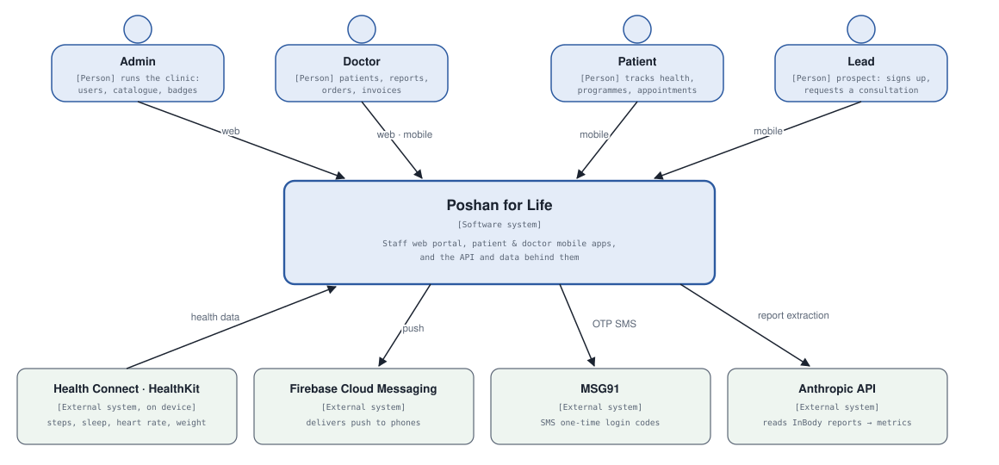
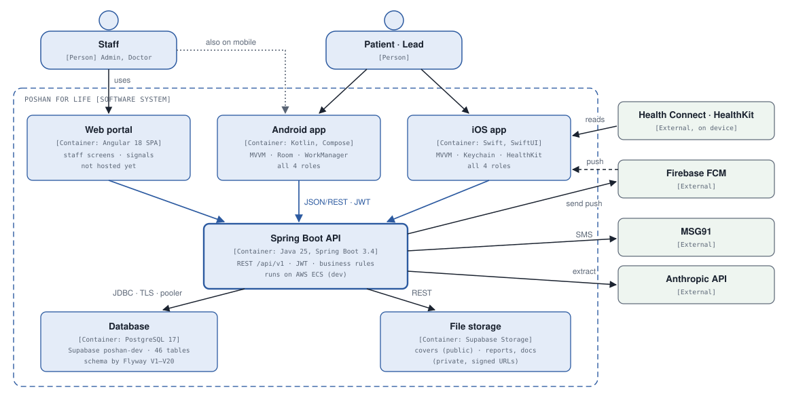
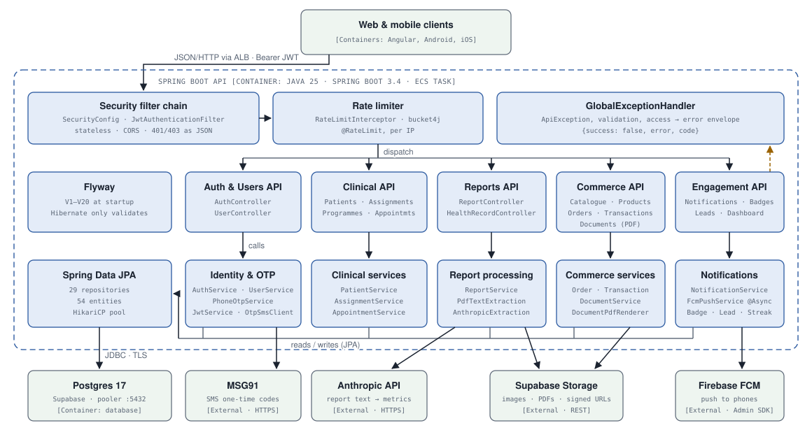
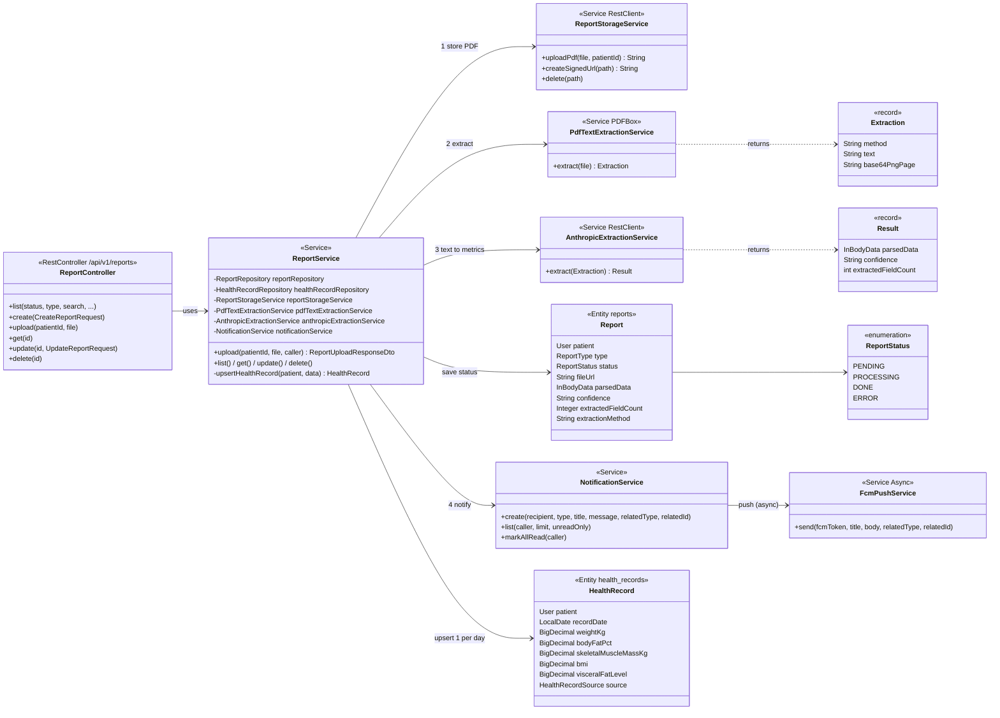
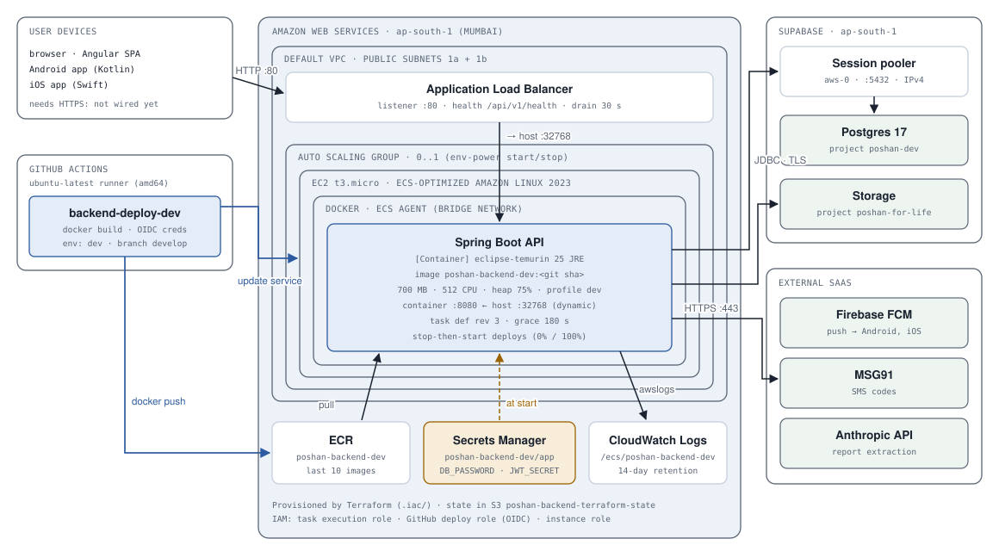

# Poshan for Life — C4 Model (backend)

The Poshan backend at every [C4](https://c4model.com/) level. Each diagram is
a close-up of one box in the diagram before it:

| Level | Diagram | Shows |
|---|---|---|
| C1 | [System context](#c1--system-context) | Who uses Poshan for Life and which outside systems it depends on |
| C2 | [Containers](#c2--containers) | The apps and data stores the system is made of |
| C3 | [Components](#c3--components-spring-boot-api) | The building blocks inside the Spring Boot API |
| C4 | [Code](#c4--code) | Classes behind authentication and report processing |
| Supplementary | [Deployment](#deployment--dev-on-aws) | Where the API container runs on AWS |

**Diagram formats:**

- **C1, C2, C3 and deployment** are hand-drawn SVG files in [`images/`](images/).
  Mermaid's automatic C4 layout tangled these four, so they're drawn by hand.
  They're plain text, so edit them in any editor and keep a box's label,
  position and arrows together.
- **The C4 code diagrams** are Mermaid `classDiagram` blocks, which GitHub and
  most IDE previews render.

Update a diagram in the same change that alters what it shows.

Related docs:

- [`AWS-INFRA-C4.md`](AWS-INFRA-C4.md): the AWS infrastructure at C1–C4, plus a catalogue of every AWS component.
- [`.iac/ARCHITECTURE.md`](../../.iac/ARCHITECTURE.md): infrastructure, deploy pipeline and runtime flows.
- [`.iac/DEPLOYMENT.md`](../../.iac/DEPLOYMENT.md): runbook.

*Read from the code on `develop`, 2026-10-10.*

---

## C1 — System context

Four roles share one system and one login model; the role in each user's JWT
decides which screens and data they get. Hosting providers (AWS, Supabase)
aren't systems at this level; they appear in C2 and in the deployment view.

---

## C2 — Containers

| Container | Technology | Runs on | Talks to |
|---|---|---|---|
| Web portal | Angular 18, Material, Tailwind | browser (hosting not set up) | API |
| Android app | Kotlin 2.0, Compose, Hilt, Retrofit, Room | Android phones | API, Firebase, Health Connect |
| iOS app | Swift, SwiftUI, URLSession | iPhones | API, Firebase, HealthKit |
| Spring Boot API | Java 25, Spring Boot 3.4, JPA, Flyway | AWS ECS on EC2 (dev); laptop locally | Database, file storage, Firebase, MSG91, Anthropic |
| Database | PostgreSQL 17 | Supabase project `poshan-dev` | – |
| File storage | Supabase Storage buckets | Supabase project `poshan-for-life` | – |

**Design rules:**

- The API is the only container that touches the database, the file store or
  any outside service, so business rules live in one place and API keys never
  ship inside a client.
- Clients open stored files directly through public or signed URLs that the
  API hands out.

---

## C3 — Components: Spring Boot API

**How a request moves through the API:**

1. Security filter chain, then the rate limiter.
2. One controller group, then its service group.
3. JPA, for anything that reads or writes data.

Only services call the outside world. Role checks sit on controller methods as
composed annotations (`@AdminOnly`, `@AdminOrDoctor`, `@PatientOnly`,
`@LeadOnly`, …, each a `@PreAuthorize` rule). Data scoping, such as a doctor
seeing only assigned patients, happens in services.

---

## C4 — Code

### Authentication and refresh-token rotation

```mermaid
classDiagram
    direction LR
    class AuthController {
        <<RestController /api/v1/auth>>
        +signup(SignupRequest)
        +login(LoginRequest)
        +refresh(RefreshTokenRequest)
        +logout(RefreshTokenRequest)
        +requestOtp(OtpRequestRequest)
        +verifyOtp(OtpVerifyRequest)
    }
    class AuthService {
        <<Service>>
        -UserRepository userRepository
        -RefreshTokenRepository refreshTokenRepository
        -JwtService jwtService
        -PasswordEncoder passwordEncoder (BCrypt)
        +signup(req) AuthResponse
        +login(req) AuthResponse
        +refresh(token) AuthResponse
        +logout(token)
        +issueTokensFor(user) AuthResponse
        -issueTokens(user) AuthResponse
    }
    class PhoneOtpService {
        <<Service>>
        -Duration OTP_TTL = 10 min
        -int MAX_ATTEMPTS = 5
        -String DEV_FIXED_OTP = "000000"
        +request(req, caller)
        +verify(req, caller) AuthResponse
        -enforceSendLimit(phone)
    }
    class JwtService {
        <<Service>>
        -SecretKey key
        -long expiryMs (15 min)
        +generateToken(userId, email, role) String
        +parseToken(token) Optional~AuthenticatedUser~
    }
    class JwtAuthenticationFilter {
        <<OncePerRequestFilter>>
        -JwtService jwtService
        #doFilterInternal(req, res, chain)
    }
    class RefreshTokenRepository {
        <<interface JpaRepository>>
        +findByTokenHash(hash) Optional~RefreshToken~
        +revokeAllForUser(userId) int
    }
    class RefreshToken {
        <<Entity refresh_tokens>>
        User user
        String tokenHash (SHA-256)
        Instant expiresAt (14 days)
        boolean revoked
    }
    class User {
        <<Entity users>>
        String name
        String email
        String passwordHash
        Role role
        String phone
        String fcmToken
    }
    class Role {
        <<enumeration>>
        ADMIN
        DOCTOR
        PATIENT
        LEAD
    }

    AuthController --> AuthService : uses
    AuthController --> PhoneOtpService : uses
    PhoneOtpService --> AuthService : issueTokensFor
    AuthService --> JwtService : sign
    AuthService --> RefreshTokenRepository : revoke old, save new
    JwtAuthenticationFilter --> JwtService : parse
    RefreshTokenRepository --> RefreshToken : stores
    RefreshToken "*" --> "1" User
    User --> Role
```

**Tokens issued at login:** a signed 15-minute JWT (user ID, email, role) and a
random refresh token.

- **Storage:** only the refresh token's **SHA-256 hash** is stored, and
  passwords are checked with BCrypt.
- **Rotation:** `refresh(token)` looks up the hash, rejects the token if it's
  revoked or expired, revokes it and saves a new one, so each refresh token
  works exactly once.
- **Consequence for clients:** they must send one refresh at a time. The
  Angular interceptor, the iOS refresh actor and (since commit `2159f6c`) the
  Android `TokenAuthenticator` all do.

### Report upload and AI extraction

**What `ReportService.upload` does, in order:**

1. Saves the report as `PROCESSING` in its own transaction, so the row
   survives a failure.
2. Stores the PDF in the private `poshan-reports` bucket.
3. Extracts the text with PDFBox. A scanned PDF with little text has page 1
   rendered as a PNG instead, for image input.
4. Sends the text or image to Anthropic for structured InBody metrics.
5. Upserts that day's `HealthRecord` (source `INBODY_UPLOAD`; the other sources
   are `MANUAL`, `PATIENT_MANUAL` and `WEARABLE_SYNC`).
6. Marks the report `DONE`, or `ERROR` on failure.
7. Creates a notification. The push itself is sent on another thread.

All of this runs **inside the upload request**. That matters for anything with
a request timeout in front of the API, such as API Gateway's 30 s limit.

---

## Deployment — dev on AWS

| Node | Runs | Scaling / lifetime |
|---|---|---|
| Application Load Balancer | Listener :80 → target group (instance targets, dynamic ports) | Always on (≈ $25/month with its 2 public IPs) |
| Auto Scaling group | Launch template: t3.micro, ECS-optimized AL2023, 30 GB gp3 | 0..1 via `env-power.sh`; replaces a dead host |
| ECS service | 1 task of family `poshan-backend-dev`, capacity provider on the ASG | Desired 0 or 1; deploys stop the old task, then start the new one |
| Container | Spring Boot fat JAR on Temurin 25 JRE, non-root user | Boots in about 85 s; healthy after 2 passing checks |
| Supabase | Postgres 17 behind the session pooler; Storage buckets | Managed; Free plan pauses after about 7 idle days |

Everything inside the AWS node is created by Terraform (`.iac/`). GitHub
Actions only pushes images and moves the service to a new task-definition
revision. Details: [`.iac/ARCHITECTURE.md`](../../.iac/ARCHITECTURE.md).
